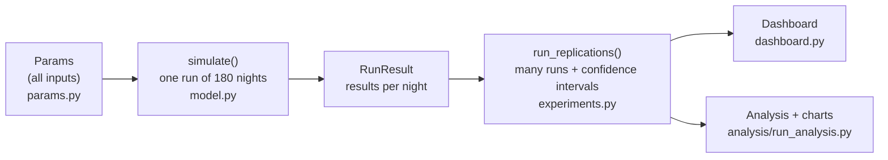

# Code Walkthrough – Presenter Guide 

This guide is for the person presenting the code (Viveca). It explains the code in plain
language, says what to show on screen and what to say, and prepares answers to likely
questions. No programming knowledge is needed to follow it.

Suggested time: **about 10 minutes walkthrough + 5 minutes live demo**.

---

## 1. The big picture (1 minute)

**What to say:** "Our code simulates a 100-room city hotel over 180 nights. Guests book,
some cancel, some don't show up. The hotel decides how many bookings to accept above its
capacity. We repeat this many times and see which overbooking level earns the most money,
and how often the hotel has to turn guests away."



| Folder / file | What it is |
|---|---|
| `hotel_sim/params.py` | All inputs in one place (hotel size, prices, cancellation rates, ...) |
| `hotel_sim/model.py` | The simulation itself: one run of the hotel |
| `hotel_sim/experiments.py` | Repeats the simulation and computes averages and confidence intervals |
| `hotel_sim/analytic.py` | The exact textbook formula (binomial), used to check our simulation |
| `dashboard.py` | The interactive app for the live demo |
| `analysis/run_analysis.py` | Produces all charts and tables for the presentation |
| `tests/` | 39 automatic checks that the code behaves correctly |
| `ASSUMPTIONS.md` | Where every input number comes from |

---

## 2. Stop 1 – The inputs (`hotel_sim/params.py`, 1.5 minutes)

**Show:** `DEFAULT_SEGMENTS` (around line 32) and the top of `class Params` (around line 43).

```python
Segment("business", 0.05, 84.0, noshow_prob=0.022, cancel_prob=0.198,
        mean_stay=2.02, mean_lead=16.7),
Segment("leisure", 0.45, 99.0, noshow_prob=0.020, cancel_prob=0.474, ...),
Segment("online portal", 0.50, 100.0, noshow_prob=0.018, cancel_prob=0.362, ...),
```

**What to say:**
- "We have three types of guests: business, leisure and online-portal bookings. Each type
  has its own price, cancellation rate, no-show rate, how far ahead they book and how long
  they stay."
- "These numbers are not invented: we calculated them from a published dataset of almost
  80,000 real bookings of a city hotel (Antonio et al., 2019). `ASSUMPTIONS.md` lists every
  source."
- "The key decision is `overbooking_level`: 0.10 means the hotel accepts bookings for up to
  110 rooms although it only has 100."

**Why it matters:** one object holds every input, so the dashboard sliders just change a
field in it.

---

## 3. Stop 2 – Creating the bookings (`model.py`, step 1 "demand", 2 minutes)

**Show:** the block under `# ---- 1. demand` (around lines 73–97).

**What to say, line by line:**
- `rng.poisson(...)`: "Every day, a random number of booking requests comes in. We use the
  Poisson distribution, the standard distribution for counting random arrivals. On busy
  weekdays and in high season the average is higher."
- `rng.choice(... p=shares)`: "Each request is randomly assigned a guest type, for example
  50% online portal."
- `rng.exponential(...)`: "How many days before arrival they book. Most book shortly before,
  a few very early."
- `1 + rng.poisson(...)`: "How many nights they stay, at least one."
- `cancels = rng.random(n) < ...cancel_prob`: "Whether this booking will be cancelled
  later – a random yes/no with the probability of its guest type."
- `rng.beta(...)`: "*When* it is cancelled. We fitted this to the real data: many people
  cancel soon after booking, some just before arrival."

**Key message:** "Every random number comes from a distribution that matches real data."

---

## 4. Stop 3 – The overbooking decision (`model.py`, step 2 "booking phase", 2 minutes)

**This is the most important part of the code.**

**Show:** the block under `# ---- 2. booking phase` (around lines 99–117), especially:

```python
if committed[a:a + s].max() + r <= limit:     # is there still room on the books?
    committed[a:a + s] += r                   # yes: accept the booking
    accepted[i] = True
...
elif accepted[i]:
    committed[a:a + s] -= r                   # cancellation frees the rooms again
```

**What to say:**
- "We go through all bookings and cancellations in time order, like the hotel's booking
  system would."
- "`limit` is capacity × (1 + overbooking level), for example 105 rooms. A booking is only
  accepted if on *every* night of the stay we are still below this limit."
- "When someone cancels, the rooms become available again for new bookings."

**Why it matters:** "This one line is the hotel's policy. Changing `overbooking_level`
changes `limit`, and everything else follows from it."

---

## 5. Stop 4 – The night itself (`model.py`, steps 3 and 4, 1.5 minutes)

**Show:** `# ---- 3. show-ups` and `# ---- 4. operations phase` (around lines 119–152).

**What to say:**
- `shows = accepted & (rng.random(n) >= p_ns)`: "Each remaining booking shows up or not,
  with the no-show probability of its guest type (about 2%)."
- The loop `for d in range(T)`: "Then we play through the nights. Guests already in the
  hotel keep their room. New arrivals get a room if one is free; otherwise they are
  *denied* (the hotel has to send them to another hotel), which costs €250 per room."
- "Free rooms can still go to walk-in guests."
- `profit = revenue - denied * denied_cost`: "Profit per night is room revenue minus
  compensation for denied guests."

**Extension 2.2 (mention briefly):** "With `shock_cv` we can make no-shows happen together,
for example on a day with a train strike. Then all guests of that day are more likely not
to show up."

---

## 6. Stop 5 – Repeating and measuring uncertainty (`experiments.py`, 1 minute)

**Show:** `run_replications` (around lines 13–39), especially:

```python
half = 1.96 * v.std(ddof=1) / np.sqrt(n_runs)
```

**What to say:**
- "One run is random, so we repeat it many times with different random numbers (seeds) and
  average the results."
- "This line is the 95% confidence interval from the lecture: mean ± 1.96 × standard
  deviation / √n. More runs make the interval narrower."
- "The seeds are fixed, so everyone who runs our code gets exactly the same numbers."
- "When we compare overbooking levels, every level uses the same random numbers (common
  random numbers). Then the differences come from the policy, not from luck."

---

## 7. Stop 6 – How we know the code is right (1 minute)

**Show:** `analysis/output/01_validation.png` and `analysis/output/01b_chi_square.png`.

**What to say:**
- "We switched off all the complicated parts (one-night stays, no cancellations, every guest
  independent). Then the number of arriving guests must follow the textbook binomial
  distribution, which we can calculate exactly."
- "Simulation and formula match: the largest difference in the probability of turning a
  guest away is 0.015, and both find the same best number of bookings."
- "A chi-square test confirms it: p = 0.25, so we do not reject that the arrivals are
  binomial. When guests are correlated, the test clearly rejects it (p < 0.001): the
  textbook formula no longer fits, and only the simulation can handle it."
- "In addition, 39 automatic tests check things like 'without overbooking nobody is ever
  turned away'."

---

## 8. Live demo (5 minutes)

**Before the presentation** (once, on the presenting laptop):

```bash
pip install -r requirements.txt
python -m streamlit run dashboard.py
```

The browser opens the dashboard. Test it once before the session; each click on
**Run simulation** takes about 5 seconds.

**Demo script:**

| Step | Do | Point out |
|---|---|---|
| 1 | Click **Run simulation** with the default settings | Average profit, occupancy (~73%), nights with denied rooms |
| 2 | Scroll to **Profit vs. overbooking level** | The curve rises, peaks at about 5–7.5% (the curve is flat there, so the dashboard may show either), then falls. The shaded band is the 95% confidence interval |
| 3 | Set **Cancellation rate** to 1.3, run again | The best level moves up (to about 20%): more cancellations → overbook more. Occupancy drops, because fewer bookings remain |
| 4 | Set it back to 1.0, set **Cost per denied room** to 1000, run again | The best level moves down (to about 2.5%): expensive mistakes → overbook less |
| 5 | (optional) Cost back to 250, **Shared no-show shock** to 0.6 | Hardly any change – with only 2% no-shows, cancellations matter much more |

**If the dashboard does not work:** show the ready-made charts in `analysis/output/`
(`02_optimum_and_risk.png`, `04_sensitivity.png`) or run
`python analysis/run_analysis.py --quick` (about 20 seconds).

---

## 9. Key results to say out loud

- Best overbooking level: **about 5%**. Profit gain: **+€49 per night (± €8)**, about +0.7%,
  or roughly €18,000 per year for 100 rooms.
- At the best level, a guest has to be turned away on about **2.4% of nights**.
- The textbook formula only looks at no-shows (2%) and recommends 1% overbooking. It loses
  **€31 per night (± €9)** compared with the simulation's best level, because it ignores
  cancellations.
- The more guests cancel and the cheaper a denied guest is, the more the hotel should
  overbook (from 2.5% up to 27.5% in our sensitivity analysis).
- Real-world check: a survey of 365 hotels found the best results with overbooking below
  5–10% (Riasi, 2018). Our result fits.

---

## 10. Likely questions and answers

**Why simulate at all if there is a formula?**
The formula only works for one night with independent guests and no cancellations. Real
hotels have multi-night stays, cancellations, groups and correlated no-shows. With those,
no closed formula exists, and our results show the formula gives the wrong answer.

**How do you know your simulation is correct?**
In the simple case where the exact answer is known, we reproduce it (validation chart and
chi-square test). Plus 39 automatic tests.

**Why the Poisson distribution for booking requests?**
It is the standard model for random arrivals that happen independently of each other
(customers, phone calls, bookings), and it only needs one parameter, the average rate.

**What is a seed?**
The starting value of the random number generator. With the same seed, the "random"
numbers are the same every time, so results are reproducible.

**Why 1.96?**
95% of a normal distribution lies within ±1.96 standard deviations of the mean. By the
central limit theorem, the average over many runs is approximately normal.

**What are common random numbers?**
All overbooking levels are simulated with the same random bookings and cancellations. So
when we compare two levels, the difference is caused by the policy, not by luck. That is
why the paired confidence intervals are so narrow.

**Why is the profit gain so small (0.7%)?**
Because only about 2% of guests do not show up, and many cancellations happen early enough
for the room to be sold again. Overbooking only helps on the busy nights when the hotel
would otherwise be full. The gain is small in percent but still about €18,000 per year.

**Where do the numbers come from?**
Mainly from a published dataset of real hotel bookings (Antonio et al., 2019, *Data in
Brief*), plus German statistics (IHA, Destatis) and the Bundeskartellamt for commissions.
See `ASSUMPTIONS.md`. Some values are our own assumptions and are marked as such there.

**What are the limitations?**
The data is from one city hotel in Lisbon before COVID. Group sizes, walk-ins and the
seasonal pattern are assumptions. Guests who are turned away only cost money once; we do
not model lost future bookings.

**Why does the shared no-show shock barely matter?**
With 2% no-shows, even a doubled no-show rate on a bad day changes only a handful of rooms.
In the chi-square example with 10% no-shows, the same shock doubles the variance of
arrivals and makes the textbook formula fail.

**How long does the simulation take?**
One run of 180 nights takes less than 0.1 seconds; the full analysis about 4 minutes.

---

## 11. Glossary

| Term | Meaning |
|---|---|
| Overbooking level | How many bookings above capacity the hotel accepts (5% = up to 105 bookings for 100 rooms) |
| Booking limit | Capacity × (1 + overbooking level) |
| No-show | Guest with a booking who does not arrive and does not cancel |
| Cancellation | Guest cancels before arrival; the room can be sold again |
| Denied / walked guest | Guest who arrives but gets no room because the hotel is full |
| Occupancy | Share of rooms that are used |
| Replication / run | One complete simulation of 180 nights |
| Confidence interval (95%) | Range that contains the true average with 95% confidence |
| Paired comparison | Comparing two policies on the same random numbers |
| Chi-square test | Statistical test whether observed frequencies match a theoretical distribution |
| CVaR 5% | Average profit of the worst 5% of nights |
